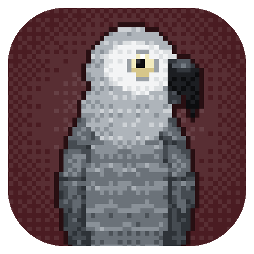
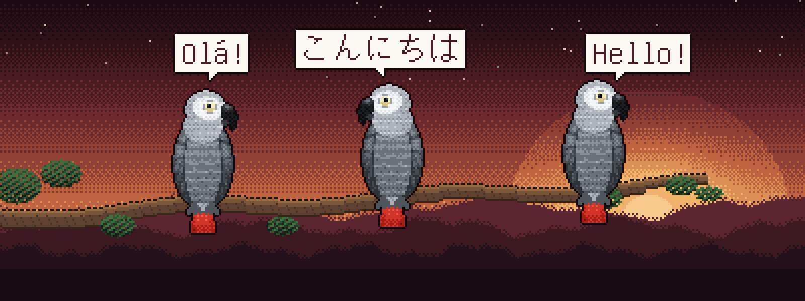
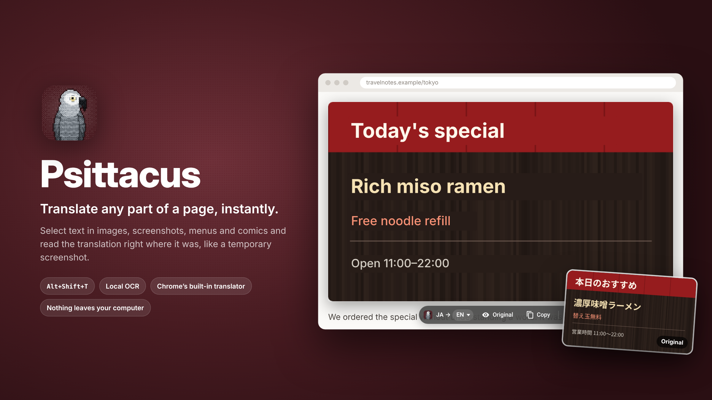

<p align="center"><a href="docs/icon-512.png"></a></p>
<h1 align="center">Psittacus</h1>

<p align="center"><i>Named after the grey parrot, the bird that repeats our words. Here it repeats them in your language.</i></p>
<p align="center">
  <a href="https://github.com/GGuilhermeAlves/Psittacus/releases/latest"></a>
  
  
  <a href="LICENSE"></a>
</p>
<p align="center">
  <a href="README.md">English</a> · <a href="README.pt-BR.md">Português</a>
</p>

<p align="center"></p>

Select any area of a page and Psittacus translates the text inside it on the spot, like Google Lens. The translation appears over a temporary screenshot of the area, in the same place, size and colours as the original text.

Everything runs **on your computer**: the capture, the text recognition (OCR) and the translation. Nothing is sent to any server.

<p align="center"></p>

## How to use

- Click the icon or press **Alt+Shift+T**, then drag over what you want to translate.
- Or right-click an image → **Translate this image**.
- Optional: a **button on the page** (in a corner of the window, over images on hover, or both). Turn it on in the options; hide it on a site with the small ×.
- On the bar: the language menu (e.g. **PT ▾**) switches the target language and remembers it, **Original** shows the original text, **Copy** copies the translation, **Esc** or a click outside closes it.
- Mixed text works: each paragraph gets its own language (Japanese, English…). Romaji is left as is.
- Manga: tick **Japanese, vertical** in the options and select just the text inside the speech bubble.

The first time you translate a language pair (say English → Portuguese), Chrome downloads its translation model once. After that it works offline.

## Requirements

Chrome 138 or newer (or Edge 148+), on desktop. Psittacus uses Chrome's built-in [Translator API](https://developer.chrome.com/docs/ai/translator-api), which isn't available on Firefox or mobile.

## Settings

Right-click the icon → **Options**:

- **Translate to:** Portuguese, English, Spanish, French, German, Italian, Japanese, Chinese, Korean or Russian.
- **Languages of the text in images:** the OCR languages. Tick only the ones you read: each extra language makes reading slower. Japanese/Chinese/Korean are read in a separate pass from Latin languages.
- **Button on the page:** off, corner, over images or both, and which corner.

## Install manually

1. Download `psittacus-<version>-chrome.zip` from the [latest release](https://github.com/GGuilhermeAlves/Psittacus/releases/latest) and extract it to a folder you won't delete.
2. Open `chrome://extensions`, turn on **Developer mode**.
3. Click **Load unpacked** and pick the extracted folder (or the `extension/` folder of a clone).

## How it works

1. The selector is injected only when you click (the `activeTab` permission). Psittacus never reads pages on its own.
2. The visible tab is captured and cropped to your selection. The image lives in memory only.
3. [Tesseract.js](https://github.com/naptha/tesseract.js) reads the text in an offscreen document, with the language data shipped inside the extension.
4. Table borders and dashed lines are painted over before OCR (they make Tesseract skip the text inside).
5. Each paragraph's language comes from its writing system (kana → Japanese, hangul → Korean…) or from Chrome's Language Detector, and the Translator API translates it.
6. Each paragraph is painted over the original with the sampled background and text colours, at the original size (shrunk if the translation is longer).

## The name

*Psittacus erithacus* is the grey parrot, famous for repeating and using human words. The icon shows it as it is in nature, body facing you and head turned to the side: scaled grey feathers, darker folded wings, a bare white face, pale eye and the hooked black beak, on a wine-red background that echoes its red tail.

## Development

The OCR engine is committed in `extension/vendor/`. To update it:

```sh
npm install
npm run vendor
npm run pack   # → dist/psittacus-<version>-chrome.zip
```

The icon is painted at 1024 px and reduced to 56×56 with Bayer dithering by `scripts/icon_art.py`; the 16 px version is drawn pixel by pixel in `scripts/icon16.py`. Run `python3 scripts/make_icons.py` from `scripts/` to regenerate.

## Licences

Psittacus: MIT. Bundled: Tesseract.js and tesseract.js-core (Apache-2.0), Tesseract language data (Apache-2.0). See `extension/vendor/` and `extension/lang/`.
