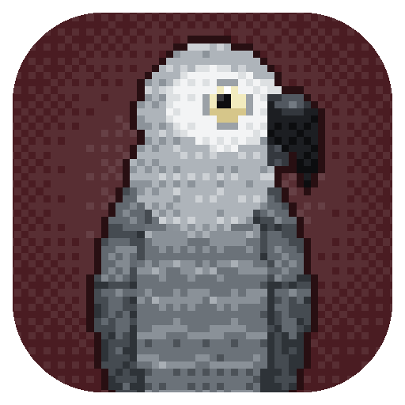
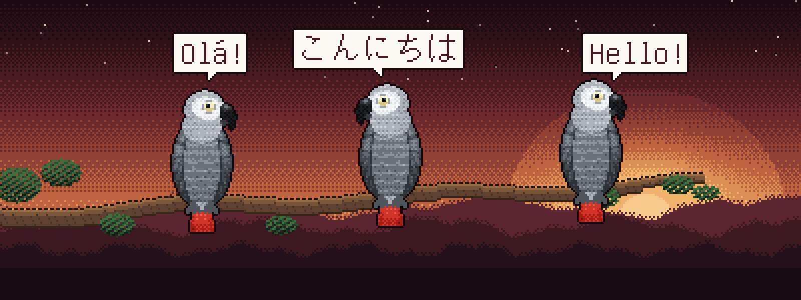
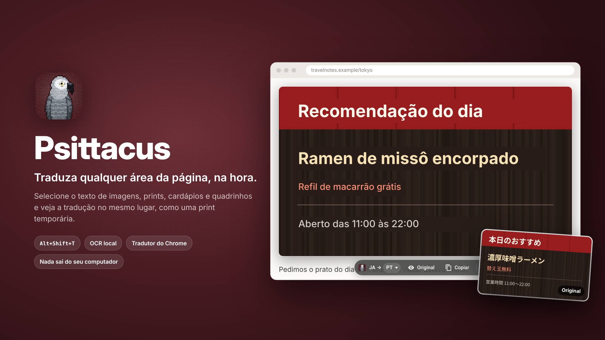

<p align="center"><a href="docs/icon-512.png"></a></p>
<h1 align="center">Psittacus</h1>

<p align="center"><i>O nome vem do papagaio-cinzento, a ave que repete as nossas palavras. Aqui, ele repete no seu idioma.</i></p>
<p align="center">
  <a href="https://github.com/GGuilhermeAlves/Psittacus/releases/latest"></a>
  
  
  <a href="LICENSE"></a>
</p>
<p align="center">
  <a href="README.md">English</a> · <a href="README.pt-BR.md">Português</a>
</p>

<p align="center"></p>

Selecione qualquer área da página e o Psittacus traduz o texto dela na hora, como o Google Lens. A tradução aparece sobre uma print temporária da área, no mesmo lugar, tamanho e cores do texto original.

Tudo roda **no seu computador**: a captura, a leitura do texto (OCR) e a tradução. Nada é enviado para nenhum servidor.

<p align="center"></p>

## Como usar

- Clique no ícone ou aperte **Alt+Shift+T** e arraste sobre o que quer traduzir.
- Ou clique com o botão direito numa imagem → **Traduzir esta imagem**.
- Opcional: um **botão na página** (no canto da janela, sobre as imagens ao passar o mouse, ou os dois). Ative nas opções; para esconder num site, use o × pequeno.
- Na barra: o menu de idioma (por exemplo **PT ▾**) troca o idioma da tradução e guarda a escolha, **Original** mostra o texto original, **Copiar** copia a tradução, e **Esc** ou um clique fora fecha.
- Texto misturado funciona: cada parágrafo tem o próprio idioma (japonês, inglês…). Romaji fica como está.
- Mangá: marque **Japonês vertical** nas opções e selecione só o texto dentro do balão.

Na primeira vez que você traduz um par de idiomas (inglês → português, por exemplo), o Chrome baixa o modelo de tradução uma vez. Depois disso funciona offline.

## Requisitos

Chrome 138 ou mais novo (ou Edge 148+), no computador. O Psittacus usa o [tradutor embutido do Chrome](https://developer.chrome.com/docs/ai/translator-api), que não existe no Firefox nem no celular.

## Configurações

Botão direito no ícone → **Opções**:

- **Traduzir para:** português, inglês, espanhol, francês, alemão, italiano, japonês, chinês, coreano ou russo.
- **Idiomas do texto nas imagens:** os idiomas do OCR. Marque só os que você lê: cada idioma a mais deixa a leitura mais lenta. Japonês, chinês e coreano são lidos numa passada separada dos idiomas latinos.
- **Botão na página:** desligado, no canto, sobre as imagens ou os dois, e em qual canto.

## Instalar manualmente

1. Baixe o `psittacus-<versão>-chrome.zip` da [última versão](https://github.com/GGuilhermeAlves/Psittacus/releases/latest) e extraia numa pasta que você não vá apagar.
2. Abra `chrome://extensions` e ative o **Modo do desenvolvedor**.
3. Clique em **Carregar sem compactação** e escolha a pasta extraída (ou a pasta `extension/`, se você clonou o repositório).

## Como funciona

1. O seletor só é colocado na página quando você clica (permissão `activeTab`). O Psittacus nunca lê páginas sozinho.
2. A aba visível é capturada e recortada na sua seleção. A imagem fica só na memória.
3. O [Tesseract.js](https://github.com/naptha/tesseract.js) lê o texto num documento offscreen, com os dados dos idiomas dentro da própria extensão.
4. Bordas de tabela e linhas tracejadas são apagadas antes do OCR (elas fazem o Tesseract pular o texto de dentro).
5. O idioma de cada parágrafo vem da escrita (kana → japonês, hangul → coreano…) ou do detector de idioma do Chrome, e o tradutor do Chrome traduz.
6. Cada parágrafo é pintado sobre o original com as cores de fundo e de texto amostradas, no tamanho original (diminuído se a tradução for mais longa).

## O nome

*Psittacus erithacus* é o papagaio-cinzento, famoso por repetir e usar palavras humanas. O ícone mostra a espécie como ela é, com o corpo de frente e a cabeça virada de lado: penas cinza em escamas, asas mais escuras, rosto branco sem penas, olho claro e o bico preto curvo, num fundo vinho que lembra a cauda vermelha.

## Desenvolvimento

O motor de OCR já está em `extension/vendor/`. Para atualizar:

```sh
npm install
npm run vendor
npm run pack   # → dist/psittacus-<versão>-chrome.zip
```

O ícone é pintado em 1024 px e reduzido para 56×56 com pontilhado por `scripts/icon_art.py`; a versão de 16 px é desenhada pixel a pixel em `scripts/icon16.py`. Para gerar de novo, rode `python3 scripts/make_icons.py` dentro de `scripts/`.

## Licenças

Psittacus: MIT. Inclui o Tesseract.js e o tesseract.js-core (Apache-2.0) e os dados de idiomas do Tesseract (Apache-2.0). Veja `extension/vendor/` e `extension/lang/`.
